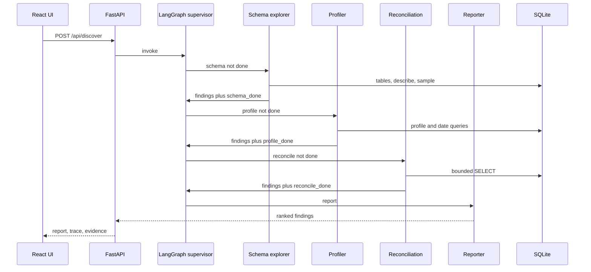

# Architecture

Enterprise Data Gaps Discovery Agent. Home lab, one workstation, no enterprise credentials.

## Context

```mermaid
flowchart LR
  ui[React UI]
  api[FastAPI]
  graph[LangGraph supervisor]
  tools[Read-only tools]
  crm[(crm.sqlite)]
  erp[(erp.sqlite)]
  wh[(warehouse.sqlite)]
  audit[Audit log]

  ui --> api
  api --> graph
  graph --> tools
  tools --> crm
  tools --> erp
  tools --> wh
  tools --> audit
```

The operator runs discovery from the React page. FastAPI starts one LangGraph pass. Specialists call the guarded tool functions. The same functions back the MCP server for an external client. The ground-truth file is for evaluation. It is not a tool.

## Containers

| Container | Now | Next |
| --- | --- | --- |
| React UI | Run button, counts, agent trace, evidence tables | Empty and error states when the API or the SQLite files are missing |
| FastAPI | `/api/health`, `/api/systems`, `/api/discover` | Persist the last report if more than one operator needs it |
| LangGraph | Supervisor plus schema, profile, reconciliation, reporter | Score the report against `metrics.json` |
| Read-only tools | Shared by the graph and the MCP server, with a JSONL audit | Keep this contract if a fifth specialist is added |
| Synthetic systems | Three SQLite files from `generate.py` | Same files until the evaluation harness is scoring well |

## Agent roles

Each finding has to cite the system, the query or tool call, and sample rows. A finding without evidence is not a finding.

| Agent | Tools | What it is looking for |
| --- | --- | --- |
| Schema explorer | `list_systems`, `tables`, `describe` | Naming drift, missing keys, tables absent from the official catalog |
| Profiler | `profile`, `sample` | Null rates, unexpected distinct values, date ranges |
| Reconciliation | `query`, `sample` | The same customer represented differently, orders and contacts with no parent, warehouse rows with no source id |
| Reporter | none against the database | Merges the evidence into a ranked report and stops |

The reporter does not get a new query tool. If the evidence is thin, the run ends with an open question instead of another unlogged SQL call.

## Sequence



## Failure modes already designed for

- An agent submits `SELECT 1; DROP TABLE orders`. The guard rejects the semicolon. The file is also opened `mode=ro`.
- An agent asks for every row. `fetchmany` stops at the cap, and the cap cannot exceed 200.
- An agent names a system as a path (`../erp`). The system name must be a bare identifier and the file must sit in `data/systems`.
- A tool call fails. The audit line still records the error. The result rows themselves are not written to the log.

## Explicit non-goals for this phase

No vector database and no document RAG. The reporter can optionally ask Ollama to phrase a summary, and that call is not required for the findings. Scoring a finished report against `data/ground_truth/metrics.json` is the next harness, not part of the agent’s tools.
