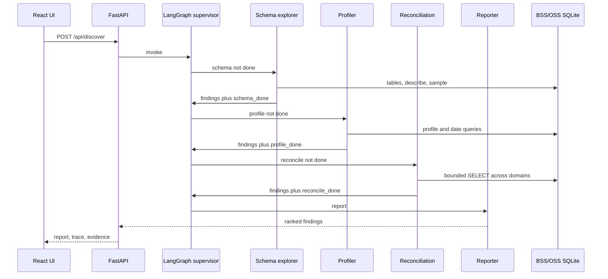

# Architecture

Enterprise Data Gaps Discovery Agent. Home lab, Telco BSS/OSS viewpoint, one workstation, no operator credentials.

## Context

```mermaid
flowchart LR
  ui[React UI]
  api[FastAPI]
  graph[LangGraph supervisor]
  tools[Read-only tools]
  bss[BSS SQLite systems]
  oss[OSS SQLite systems]
  bi[Analytics extract]
  audit[Audit log]

  ui --> api
  api --> graph
  graph --> tools
  tools --> bss
  tools --> oss
  tools --> bi
  tools --> audit
```

The operator runs discovery from the React page. FastAPI starts one LangGraph pass. Specialists call the guarded tool functions across BSS, OSS, and BI. The ground-truth file is for evaluation. It is not a tool.

## Domains

| Layer | Systems |
| --- | --- |
| BSS | crm, product_catalog, order_management, billing |
| OSS | service_inventory, resource_inventory, assurance |
| BI | analytics |

## Containers

| Container | Now | Next |
| --- | --- | --- |
| React UI | Run button, counts, agent trace, evidence tables | Domain filters by BSS / OSS / BI |
| FastAPI | `/api/health`, `/api/systems`, `/api/discover` | Persist the last report if more than one operator needs it |
| LangGraph | Supervisor plus schema, profile, reconciliation, reporter | Score the report against `metrics.json` |
| Read-only tools | Shared by the graph and the MCP server, with a JSONL audit | Keep this contract if a fifth specialist is added |
| Synthetic systems | Eight SQLite files from `generate.py` | Same files until the evaluation harness is scoring well |

## Agent roles

| Agent | Tools | What it is looking for |
| --- | --- | --- |
| Schema explorer | `list_systems`, `tables`, `describe` | BSS/OSS inventory, party-key drift, tables absent from the official catalog |
| Profiler | `profile`, `sample` | Null bill emails, lifecycle encodings, analytics freshness |
| Reconciliation | `query`, `sample` | Party, order, offer, CFS, resource, and ticket mismatches |
| Reporter | none against the database | Merges the evidence into a ranked report and stops |

## Sequence



## Failure modes already designed for

- An agent submits `SELECT 1; DROP TABLE product_order`. The guard rejects the semicolon. The file is also opened `mode=ro`.
- An agent asks for every row. `fetchmany` stops at the cap, and the cap cannot exceed 200.
- An agent names a system as a path (`../billing`). The system name must be a bare identifier and the file must sit in `data/systems`.
- A tool call fails. The audit line still records the error.

## Explicit non-goals for this phase

No live operator feeds, no TMF Open API gateway, and no document RAG. The reporter can optionally ask Ollama to phrase a summary. Scoring a finished report against `metrics.json` is the next harness.
